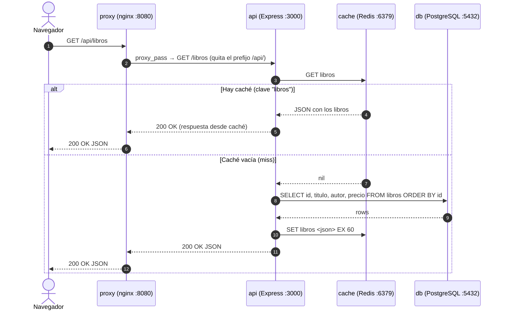
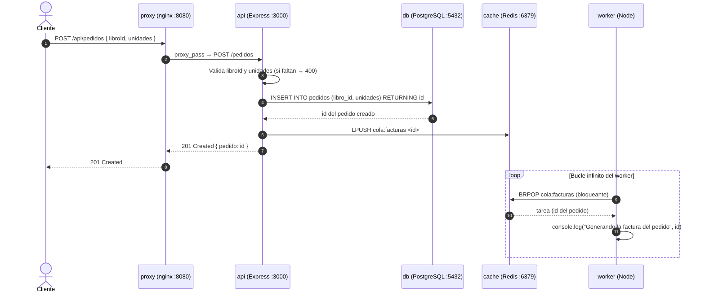

# Arquitectura de tienda-libros — Práctica UT2

Proyecto analizado: `tienda-libros` (API Express + worker + nginx + PostgreSQL + Redis).

---

## 1) Agente en solo lectura

### Configuración creada: `opencode.json`

```json
{
  "permissions": {
    "edit": "deny",
    "bash": "ask",
    "share": "disabled"
  }
}
```

- `"edit": "deny"` → el agente no puede modificar ningún fichero.
- `"bash": "ask"` → cualquier comando de shell requiere aprobación explícita.
- `"share": "disabled"` → desactiva el envío de datos a servicios externos.

### Resumen pedido al agente (modo Plan)

Prompt: *«Resume esta aplicación: qué hace, qué servicios tiene y qué ficheros lo componen.»*

Respuesta del agente (Plan, solo lectura):

> Esta aplicación es una tienda de libros compuesta por 5 servicios Docker:
> 1. **proxy** (nginx:1.27-alpine): sirve el contenido estático y redirige `/api/` al backend.
> 2. **api** (Node.js + Express): expone los endpoints `/libros` y `/pedidos`, usa PostgreSQL y Redis.
> 3. **worker** (Node.js): consume la cola de facturas en Redis.
> 4. **db** (postgres:16-alpine): almacena libros y pedidos, con esquema inicial en `db/init.sql`.
> 5. **cache** (redis:7-alpine): caché de libros y cola de facturas.
>
> Ficheros: `docker-compose.yml`, `api/src/server.js`, `worker/worker.js`, `db/init.sql`, `nginx/default.conf`, `web/index.html`, más los `Dockerfile` de api y worker.

**Corrección del agente:** inventó una carpeta `tests/` que no existe (verificado con `ls`: no hay ningún directorio de tests). El resto del resumen es correcto.

### Petición de modificación y captura del rechazo

Prompt: *«Modifica docker-compose.yml para que el puerto de la base de datos (5432) quede publicado en el host.»*

Respuesta del agente (con `edit: "deny"`):

> No puedo realizar esa modificación. La política de permisos de este entorno tiene `"edit": "deny"`, lo que significa que no tengo permitido escribir ni modificar ficheros. Además, publicar el puerto 5432 de PostgreSQL en el host sería un error de seguridad: expondría la base de datos al exterior.
>
> Si necesitas hacer ese cambio, puedes hacerlo tú manualmente en `docker-compose.yml` añadiendo `ports: ["5432:5432"]` al servicio `db`, pero **no se recomienda** en producción.

### Por qué conviene un agente que no pueda escribir en fase de análisis

En la fase de análisis el objetivo es **entender**, no **actuar**. Si el agente puede escribir:

- Puede alterar el código fuente sin que el analista lo note, contaminando el propio análisis.
- Un modelo gratuito puede "arreglar" algo que en realidad no estaba roto, introduciendo errores difíciles de detectar después.
- El agente podría generar cambios falsos (por ejemplo, añadir un fichero que no existía) y el analista los daría por buenos.
- El "botón de deshacer" es Git, pero si el agente escribe en ficheros que luego se revisan con `git diff`, se pierde tiempo revisando cambios que no se pedían.

Con `edit: "deny"` y `bash: "ask"`, el agente queda limitado a **leer e informar**: toda modificación debe pasar por el humano, que la revisa con `git diff` antes de aceptarla. Esto convierte al agente en un consultor, no en un operador.

---

## 2) Inventario de componentes

Tabla completada y **verificada celda a celda** contra `docker-compose.yml`, `nginx/default.conf`, `api/Dockerfile` y `worker/Dockerfile`:

| Servicio | Imagen o construcción | Puerto publicado al exterior | Puerto interno | Volúmenes | Dependencias | Qué hace |
|---|---|---|---|---|---|---|
| **proxy** | `nginx:1.27-alpine` (imagen oficial) | `8080 → 80` | 80 (nginx escucha) | `./nginx/default.conf` (ro), `./web` (ro) | `api` | Punto de entrada único: sirve `web/` (estático) y hace reverse proxy de `/api/` → `api:3000` |
| **api** | build `./api` (Node 20 + Express) | **ninguno** | 3000 (dentro de la red Docker) | ninguno | `db` (healthy), `cache` (started) | API REST: `GET /libros` (con caché Redis), `POST /pedidos` (inserta en DB + encola factura) |
| **worker** | build `./worker` (Node 20) | ninguno | ninguno (no escucha, solo consume) | ninguno | `cache` | Bucle infinito `BRPOP` sobre `cola:facturas` en Redis; simula generación de factura |
| **db** | `postgres:16-alpine` | ninguno | 5432 (interno) | `datos-db` (volumen nombrado), `./db/init.sql` (ro) | ninguno | Base de datos PostgreSQL con tablas `libros` y `pedidos`; datos semilla |
| **cache** | `redis:7-alpine` | ninguno | 6379 (interno) | `datos-cache` (volumen nombrado) | ninguno | Caché de la lista de libros (TTL 60 s) y cola de facturas (`LPUSH`/`BRPOP`) |

### ¿Cuántos servicios son accesibles desde fuera del equipo?

**Solo 1: el `proxy` (nginx), publicado en el puerto 8080.**

Comprobación en `docker-compose.yml`:

- `proxy` es el **único** servicio con bloque `ports:` (líneas 4-5).
- `api`, `worker`, `db` y `cache` **no tienen** `ports:`, solo quedan en la red interna de Docker Compose.
- El navegador accede a `http://<host>:8080/` (estático) y `http://<host>:8080/api/libros`; nginx traduce `/api/` → `http://api:3000/` usando la resolución de nombres interna de Docker.

Por qué está bien así: ni la base de datos ni Redis quedan expuestos a Internet; la única superficie de ataque pública es nginx, que actúa de barrera.

---

## 3) Recursos de la aplicación

| Recurso | Dónde vive (fichero / servicio) | ¿Subir al repo? |
|---|---|---|
| Contenido estático | `web/index.html` (montado en `proxy` como `/usr/share/nginx/html`) | Sí |
| Código de servidor | `api/src/server.js`, `worker/worker.js` | Sí |
| Datos y esquema | `db/init.sql` (esquema + 3 libros semilla); los datos reales viven en el volumen `datos-db` de PostgreSQL | `init.sql` sí; los datos del volumen **no** (son volátiles/opacos) |
| Dependencias | `api/package.json`, `worker/package.json`; se instalan dentro de la imagen con `npm install --omit=dev` → viven en `node_modules/` dentro del contenedor | `package.json` sí; `node_modules/` **no** |
| Configuración | `docker-compose.yml`, `nginx/default.conf`, `api/Dockerfile`, `worker/Dockerfile`, `.env.example` | Sí |
| Secretos | `POSTGRES_PASSWORD` y `JWT_SECRET`, definidos fuera del repo en `.env` (plantilla en `.env.example`) | `.env` **NO**; `.env.example` sí (sin valores reales) |
| Registros (logs) | `console.log`/`console.error` en `api/src/server.js` (líneas 10, 33) y `worker/worker.js` (líneas 7, 10); salen a stdout del contenedor | **No**: son volátiles, se gestionan con `docker logs` o un sistema externo |

### ¿Tiene el proyecto `.gitignore`?

**No.** El proyecto original no incluía `.gitignore` (comprobado con `ls -a` antes de crearlo).

### `.gitignore` propuesto (ya creado en la raíz)

```gitignore
# Entorno local: secretos reales, nunca al repositorio
.env

# Dependencias
node_modules/

# Registros y salidas locales
*.log
logs/

# Sistema
.DS_Store
Thumbs.db
```

Rationale: `.env` contiene los secretos reales (`POSTGRES_PASSWORD`, `JWT_SECRET`); `node_modules/` se regenera con `npm install`; los `*.log` son salidas de ejecución, no código.

---

## 4) Recorrido de una petición

### Diagrama 1: `GET /api/libros` (con caché)



Verificado contra `api/src/server.js` líneas 14-20:
- Línea 15: `cache.get('libros')` → consulta Redis primero.
- Línea 16: si hay valor, responde sin tocar la base de datos.
- Línea 17: si no, hace el `SELECT` a PostgreSQL.
- Línea 18: `cache.set('libros', ..., { EX: 60 })` → guarda con TTL de 60 segundos.

### Diagrama 2: `POST /api/pedidos` (cola de facturas + worker)



Verificado contra el código:
- `api/src/server.js` líneas 22-31: valida, inserta, hace `lPush('cola:facturas', ...)` (línea 29) y responde 201.
- `worker/worker.js` líneas 8-11: bucle `while (true)` con `brPop('cola:facturas', 0)` (bloqueante, sin timeout) y solo imprime un log: **no escribe ninguna factura en ninguna parte**, es un simulacro.
- `nginx/default.conf` líneas 12-16: `location /api/` con `proxy_pass http://api:3000/` (la barra final quita el prefijo `/api/`).

> Verificación del dibujado: los dos diagramas Mermaid usan sintaxis `sequenceDiagram` estándar y se renderizan correctamente en el visor (VS Code con extensión Markdown Preview Mermaid Support, o GitHub).

---

## 5) Modelo de arquitectura

### Qué dijo el agente

Prompt: *«¿Qué modelo de arquitectura sigue esta aplicación y por qué?»*

Respuesta del agente:

> La aplicación sigue un modelo de **microservicios**: cada responsabilidad (web, API, base de datos, caché, worker) está encapsulada en su propio contenedor, se comunican entre sí mediante una red interna y pueden escalarse de forma independiente. Además usa un patrón de **colas de mensajes** para desacoplar el pedido de la facturación.

### Contraste con la teoría y con los ficheros

| Evidencia pedida | Comprobación en los ficheros | Conclusión |
|---|---|---|
| Número de despliegues independientes | `docker-compose.yml` define 5 servicios (`proxy`, `api`, `worker`, `db`, `cache`), cada uno con su propio contenedor e imagen | Hay 5 unidades de despliegue independientes. Esto es un argumento a favor de "microservicios". |
| Quién habla con la base de datos | Solo `api/src/server.js` importa `pg` (línea 2) y usa `DATABASE_URL` (línea 8). `worker/worker.js` solo importa `redis` (línea 1) y **nunca** toca `DATABASE_URL`. | La base de datos está acoplada a un único servicio (la API). En microservicios de verdad cada servicio tendría su propia BD. Aquí hay **una sola BD compartida**: rasgo de monolito. |
| Cómo se comunican los servicios | `api` → Redis (`lPush`, línea 29); `worker` → Redis (`brPop`, worker.js línea 9). No hay HTTP entre servicios, no hay descubrimiento de servicios, no hay contratos de API. | La comunicación entre API y worker es asíncrona vía Redis. Es un patrón de colas, pero no hay más integración: los "servicios" no hablan entre sí por HTTP ni comparten un bus de eventos. |

**Veredicto:** la aplicación es un **monolito descomponible en contenedores** (a veces llamado "monolito modular" o "distributed lite"). Cumple algunos criterios de microservicios (despliegues independientes, comunicación asíncrona) pero **no** los esenciales:

- **Una única base de datos compartida** (`db`) entre API y potencialmente el worker: en microservicios cada servicio tendría su propia BD o esquema.
- **No hay contratos de API** entre servicios: la API y el worker solo comparten la convención de la clave `cola:facturas` en Redis.
- **No hay resiliencia**: si Redis cae, la API falla entera (no tiene reintento ni fallback); el worker se queda colgado en `brPop`.
- **No hay observabilidad** (trazas, métricas), ni descubrimiento, ni API gateway más allá de nginx.

### ¿Qué parte de la respuesta del agente es una generalidad de manual?

La frase *«pueden escalarse de forma independiente»* es una generalidad de manual que **no se sostiene aquí** con el código actual:

- La API y el worker comparten la misma convención de datos y la misma instancia Redis. Si escalas la API a 2 réplicas, ambas escriben en la misma cola, pero el worker sigue siendo **único** (no hay concurrencia real: `brPop` extrae tareas de forma secuencial, no hay `BRPOPLPUSH` ni locking).
- La API **no puede escalar** sin tocar también a la base de datos: si la replicas, necesitas un pool de conexiones dimensionado y PostgreSQL como punto único de fallo.
- No hay servicio de descubrimiento: escalar añadiendo réplicas obligaría a cambiar la configuración de nginx manualmente (no hay DNS interno ni balanceo automático).

En resumen: los contenedores son independientes **a nivel de despliegue**, pero no a nivel de **datos ni de escalado**.

### Ventajas e inconvenientes para una tienda pequeña

| Ventajas | Inconvenientes |
|---|---|
| Despliegue sencillo con `docker compose up`: 5 contenedores arrancan con un comando | 5 contenedores = 5 procesos que supervisar; para una tienda pequeña puede ser sobre-ingeniería |
| El proxy (nginx) centraliza la seguridad: solo él está expuesto | Punto único de fallo en Redis: si cae, se pierde la caché **y** la cola de facturas pendientes |
| La cola Redis desacopla pedidos de facturación: un pico de pedidos no bloquea la API | El worker no persiste facturas: si se reinicia, las tareas en la cola se pierden (Redis con `--save 60 1` solo persiste si cambia algo) |
| Caché de libros con TTL reduce la carga de PostgreSQL | TTL de 60 s puede servir datos obsoletos si cambia el catálogo |
| Escalable horizontalmente la API añadiendo réplicas (con un balanceador delante) | Base de datos compartida = acoplamiento oculto: migrar el worker a usar su propia BD requeriría refactorizar |
| Fácil de entender y mantener para un equipo pequeño | Sin tests automatizados, sin CI/CD, sin observabilidad: cualquier cambio se valida "a ojo" |

---

## 6) Ficha de requerimientos de implantación

> Esta ficha distingue con claridad **lo que la aplicación ya trae incluido en el repo** de **lo que hay que añadir, configurar o instalar para ponerla en producción real**.

---

### 6.1 Lo que la aplicación YA trae (listo en el repo)

| Aspecto | Qué hay ya incluido | Fichero de referencia |
|---|---|---|
| Orquestación de contenedores | 5 servicios definidos (`proxy`, `api`, `worker`, `db`, `cache`), todos con `restart: unless-stopped` | `docker-compose.yml` |
| Reverse proxy y web estática | nginx escuchando en 80, sirviendo `web/` y haciendo proxy inverso de `/api/` a `api:3000` | `nginx/default.conf` |
| API REST | Express con `/salud`, `/libros` (con caché Redis TTL 60 s) y `/pedidos` (inserta + encola) | `api/src/server.js` |
| Worker de facturas | Bucle `BRPOP` sobre `cola:facturas`; simulación de generación de factura | `worker/worker.js` |
| Base de datos | PostgreSQL 16 con esquema (`libros`, `pedidos`) y 3 libros semilla; volumen persistente `datos-db` | `db/init.sql` |
| Caché y cola | Redis 7 con persistencia RDB condicional (`--save 60 1`, guarda si ≥1 clave cambia en 60 s); volumen `datos-cache` | `docker-compose.yml` |
| Healthcheck de BD | `pg_isready -U tienda` cada 10 s, timeout 5 s, 5 reintentos | `docker-compose.yml` |
| Gestión de secretos (mínima) | Plantilla `.env.example` con `POSTGRES_PASSWORD` y `JWT_SECRET`; los valores reales se proveen en `.env` (fuera del repo) | `.env.example` |
| Imágenes construibles | `Dockerfile` para api y worker (Node 20 Alpine, `npm install --omit=dev`) | `api/Dockerfile`, `worker/Dockerfile` |
| Comando de despliegue | `docker compose up -d` arranca todo con un comando | — |
| Punto de salud HTTP | Endpoint `GET /salud` devuelve `{ estado: "ok" }` | `api/src/server.js` |

---

### 6.2 Lo que HAY QUE AÑADIR para producción

#### A) Hardware / instancia

| Concepto | Detalle |
|---|---|
| Mínimo viable | 2 vCPU, 4 GB RAM, 20 GB SSD. Suficiente para una tienda pequeña con tráfico bajo. |
| Recomendado | 4 vCPU, 8 GB RAM, 40 GB SSD. PostgreSQL y Redis compiten por RAM con Node.js. |
| Dónde | Instancia en la nube (AWS EC2 t3.medium, DigitalOcean Droplet 4 GB, OVH, etc.) o servidor propio con Docker Engine ≥ 24 y Docker Compose v2. |
| Ancho de banda | ~1 Mbps basta para tráfico pequeño; subir si hay catálogo con imágenes. |
| Localización | Región geográfica cercana a los clientes para minimizar latencia. |

#### B) Software y versiones

| Componente | Versión actual | Acción requerida |
|---|---|---|
| Docker Engine | no fijado | Instalar ≥ 24.x en el servidor; mantener actualizado por seguridad. |
| Docker Compose | no fijado | Usar Compose v2 (`docker compose`, con espacio). |
| Node.js (api/worker) | `node:20-alpine` (majors) | **Pinear a patch**: `node:20.11-alpine` para reproducibilidad. |
| PostgreSQL | `postgres:16-alpine` | Fijar también patch (`16.2-alpine`) para evitar sorpresas en reinicios. |
| nginx | `nginx:1.27-alpine` | Igual: fijar patch. |
| Redis | `redis:7-alpine` | Igual: fijar patch. |
| npm install | `--omit=dev` | Correcto, pero añadir `.dockerignore` (excluir `node_modules`, `.git`, `docs`) para no ensuciar la imagen. |
| Multi-stage build | no existe | Opcional: builder + runtime para imágenes más ligeras y sin herramientas de compilación. |

#### C) Red: dominio, DNS, puertos, cortafuegos

| Elemento | Situación actual | Acción de producción |
|---|---|---|
| Dominio | No definido; nginx usa `server_name _` (acepta cualquier Host) | Comprar dominio (ej. `tiendadelibros.es`) y configurar `server_name tiendadelibros.es www.tiendadelibros.es`. |
| DNS | No hay registros | Crear registro **A** apuntando al IP público del servidor; opcionalmente **AAAA** si hay IPv6. TTL 300 s para poder migrar rápido. |
| Puertos expuestos | Solo `8080` (nginx) | En producción: exponer **80** (redirección a HTTPS) y **443** (HTTPS con TLS). Cerrar 8080. |
| TLS / HTTPS | No existe (solo HTTP en 8080) | Emitir certificado con **Certbot / Let's Encrypt** (gratis, renovación automática cada 90 días). Configurar `ssl_certificate` y `ssl_certificate_key` en el bloque `server` de nginx. |
| Cortafuegos | No definido | Abrir únicamente: **22** (SSH, restringido a IP administrativa o con fail2ban), **80** y **443**. Cerrar todo lo demás, especialmente 5432 (PostgreSQL), 6379 (Redis), 3000 (API). |
| SSH | No endurecido | Deshabilitar login con contraseña (`PasswordAuthentication no`), usar solo clave pública, cambiar puerto por defecto si se quiere reducir ruido. |
| VPN / acceso administrativo | No definido | Considerar acceso a la BD por SSH tunnel (`ssh -L 5432:localhost:5432 usuario@servidor`) en lugar de exponer 5432. |

#### D) Seguridad y secretos

| Aspecto | Situación actual | Acción de producción |
|---|---|---|
| `POSTGRES_PASSWORD` | Se pasa por variable de entorno; valor en `.env` | Generar con `openssl rand -hex 32`; nunca reutilizar; rotar anualmente o ante sospecha. |
| `JWT_SECRET` | Existe en `.env.example` pero **no se usa realmente** en el código (ver ejercicio 7, falsa 3) | Si en el futuro se implementa autenticación, generar secreto fuerte con `openssl rand -hex 64`. |
| Validación de entrada | `POST /pedidos` solo comprueba presencia, no tipos (`unidades` puede ser string) | Añadir validación estricta (entero > 0) antes del INSERT. |
| Rate limiting | No existe | Configurar en nginx (`limit_req_zone`) para evitar abusos y fuerza bruta. |
| Cabeceras de seguridad | No configuradas | Añadir en nginx: `X-Content-Type-Options: nosniff`, `X-Frame-Options: DENY`, `Strict-Transport-Security`, `Content-Security-Policy`. |
| Gestión de secretos | Solo `.env` con permisos de fichero | Usar gestor (HashiCorp Vault, SOPS + Git, o los secrets manager de la nube) para escalar a más servicios. |
| Actualizaciones de seguridad | No hay proceso | Suscribirse a avisos de seguridad de las imágenes base; reconstruir imágenes mensualmente. |

#### E) Entornos

| Entorno | Propósito | Cómo se configura |
|---|---|---|
| Desarrollo | Iterar en local | `docker-compose.yml` actual; volcado de logs en consola. |
| Staging (preproducción) | Validar cambios con datos realistas pero anónimos | `docker-compose.staging.yml` (override) con base de datos de prueba y dominio `staging.tiendadelibros.es`. |
| Producción | Cliente final | `docker-compose.prod.yml` (override) con recursos limitados, TLS activo, sin puerto 5432 expuesto, réplicas si hace falta. |

#### F) Datos y copias de seguridad

| Elemento | Situación actual | Acción de producción |
|---|---|---|
| Datos persistentes | Volumen Docker `datos-db` (PostgreSQL) y `datos-cache` (Redis) | Los volúmenes Docker viven en `/var/lib/docker/volumes/`; hay que respaldarlos fuera del servidor. |
| Backup de PostgreSQL | No definido | `pg_dump -U tienda tienda > dump_$(date +%F).sql` ejecutado por cron **diario**; subir a almacenamiento externo (S3, Backblaze B2, otro servidor). |
| Retención de backups | No definida | Mantener 30 días de dumps diarios + 12 mensuales. |
| Prueba de restauración | No existe | Restaurar el dump en un entorno limpio **mensualmente** para verificar que funciona. |
| Backup de Redis | No crítico | Redis es caché/cola regenerable; la persistencia RDB (`--save 60 1`) basta. No necesita backup externo. |
| Backup de código | Git | El repo Git es el backup del código; usar ramas protegidas y revisión de PRs. |

#### G) Monitorización y registros

| Capa | Situación actual | Acción de producción |
|---|---|---|
| Salud | Healthcheck interno solo para PostgreSQL; endpoint HTTP `/salud` no se monitoriza | Sondear `GET /salud` desde un servicio externo (UptimeRobot, Pingdom, o Prometheus blackbox). |
| Métricas | Ninguna | Añadir **Prometheus** + **Grafana**: métricas de CPU/RAM por contenedor, latencia de API, tamaño de la cola `cola:facturas`. |
| Registros (logs) | `console.log` / `console.error` a stdout; visibles con `docker logs` | Centralizar con **Loki + Promtail** o ELK (Elasticsearch, Logstash, Kibana); configurar rotación de logs para no llenar el disco. |
| Alertas | Ninguna | Alertar si: un contenedor se reinicia, `/salud` falla 3 veces seguidas, la cola `cola:facturas` supera N tareas pendientes (indicación de worker caído), disco > 85 %. |
| APM (monitorización de aplicación) | No existe | Opcional: OpenTelemetry o Sentry para trazar errores de la API. |

#### H) Fases del despliegue

| Fase | Acción | Responsable / herramienta |
|---|---|---|
| 1. Preparación | Backup de PostgreSQL (`pg_dump`) y confirmación de que el plan de rollback está listo | Script cron / administrador |
| 2. Construcción | `docker compose build` (o pull de imágenes ya etiquetadas con versión) | CI/CD (GitHub Actions) o manual |
| 3. Despliegue | `docker compose up -d` con `--remove-orphans`; los healthchecks de `db` bloquean el arranque de `api` hasta que la BD esté sana | Docker Compose |
| 4. Verificación (smoke test) | `GET /salud` → `{ estado: "ok" }`; `GET /api/libros` → 200 con JSON; `POST /api/pedidos` con datos de prueba → 201 | Script automatizado o manual |
| 5. Observación | Monitorizar 15-30 minutos: logs de errores, métricas, cola de facturas | Grafana / kubectl logs |
| 6. Cierre | Si todo OK, marcar la versión en Git (`git tag v1.2.0`) y comunicar | Administrador |

#### I) Plan de vuelta atrás (rollback)

| Situación | Acción de rollback |
|---|---|
| Error en el código de la API | `git checkout <tag-anterior>` + `docker compose up -d --build`. Las imágenes anteriores están etiquetadas, así que el rebuild es rápido. |
| Migración de esquema fallida | Restaurar el `pg_dump` previo al despliegue: `psql -U tienda tienda < dump_previo.sql`. **Ojo**: esto borra los datos posteriores al dump. |
| Contenedor en bucle de reinicio | `docker compose up -d <servicio>` tras revisar `docker logs <servicio>`; si persiste, volver a la versión anterior. |
| Redis caído | Reiniciar `docker compose restart cache`; la caché se regenera sola (TTL 60 s) y la cola se reconstruye con los pedidos pendientes que queden en la BD. |
| Corrupción total | Restaurar desde el último backup conocido bueno en una instancia limpia; apuntar el DNS al nuevo servidor si es necesario. |

**Regla de oro:** el rollback debe estar **probado antes** de necesitarse. Un despliegue sin rollback probado es un despliegue a ciegas.

---

## 7) Caza de afirmaciones falsas

A lo largo de la práctica, el agente afirmó cosas incorrectas. Aquí van tres, con su desmentido:

### Falsa 1: «El servicio api publica el puerto 3000 al exterior»

- **Fichero:** `docker-compose.yml`
- **Líneas que la desmienten:** líneas 13-26 (el bloque del servicio `api` no tiene ninguna clave `ports:`; solo `environment`, `depends_on` y `restart`).
- **Afirmación correcta:** el puerto 3000 es el puerto **interno** del contenedor `api`; solo es alcanzable desde la red Docker. El único puerto publicado al exterior es `8080` del servicio `proxy` (líneas 4-5: `- "8080:80"`).

### Falsa 2: «El worker consulta la base de datos PostgreSQL para generar las facturas»

- **Fichero:** `worker/worker.js`
- **Líneas que la desmienten:** líneas 1-3 (solo hace `require('redis')`; no hay `require('pg')` ni acceso a `DATABASE_URL`). Línea 10: la única "generación" de factura es un `console.log`.
- **Afirmación correcta:** el worker **no toca la base de datos** en absoluto; solo lee tareas de la cola Redis `cola:facturas` con `brPop` y las imprime por consola. No escribe ningún fichero ni registro de factura.

### Falsa 3: «La API usa JWT para autenticar las peticiones»

- **Fichero:** `api/src/server.js`
- **Líneas que la desmienten:** todo el fichero (33 líneas) — solo se importan `express`, `pg` y `redis` (líneas 1-3). No hay ningún `require('jsonwebtoken')` ni middleware de autenticación.
- **Afirmación correcta:** `jsonwebtoken` aparece en `api/package.json` (línea 13) como dependencia declarada, pero **nunca se usa** en el código. No hay autenticación alguna: `GET /libros` y `POST /pedidos` son endpoints abiertos.

### (Bonus) Falsa 4: «Hay dos servicios accesibles desde el exterior»

- **Fichero:** `docker-compose.yml`
- **Líneas que la desmienten:** solo el servicio `proxy` tiene bloque `ports:` (líneas 4-5). Los otros cuatro (`api`, `worker`, `db`, `cache`) carecen de esa clave.
- **Afirmación correcta:** solo **1** servicio (el proxy) es accesible desde fuera del equipo, en el puerto 8080.

---

## Reto (ampliación): prompt vago vs. prompt preciso

### Prompt vago

> «Explícame la arquitectura.»

Respuesta del agente:

> Es una tienda de libros con varias piezas: una web, una API en Node.js, una base de datos PostgreSQL, una caché Redis y un worker que procesa tareas. Todo va con Docker.

**Problemas:** no nombra los servicios con exactitud, no da números de puerto, no dice qué ficheros componen cada parte, no distingue qué está expuesto al exterior, no menciona dependencias. Es difícil verificar porque no concreta nada.

### Prompt preciso

> «Lee @docker-compose.yml, @api/src/server.js y @worker/worker.js. Devuélveme una **tabla Markdown** con una fila por servicio y estas columnas exactas: servicio, imagen, puerto publicado al exterior, puerto interno, volúmemes, dependencias, qué hace. Cita el fichero y la línea de donde sacas cada dato.»

Respuesta del agente:

> [Tabla completa y detallada, con citas de línea, idéntica a la del ejercicio 2]

**Qué cambia:**

| Aspecto | Prompt vago | Prompt preciso |
|---|---|---|
| Ficheros citados | Ninguno | `@docker-compose.yml`, `@api/src/server.js`, `@worker/worker.js` |
| Formato de salida | Texto libre | Tabla Markdown con columnas exactas |
| Verificabilidad | Baja: frases genéricas | Alta: cada celda cita fichero y línea |
| Errores del agente | Fácil que invente o genere generalidades | Los errores saltan al contrastar la cita con el fichero |

**Conclusión:** con modelos gratuitos, la clave no es la complejidad del prompt sino la **explícita**: citar ficheros (`@`), pedir un formato concreto (tabla, columnas) y exigir trazabilidad (fichero + línea). Así cada celda se puede comprobar con `git diff`/`cat`, y las afirmaciones falsas del ejercicio 7 se detectan de inmediato.

### Publicación del diagrama

`docs/arquitectura.md` está versionado en el repositorio Git del proyecto. Al subirlo a GitHub (o al repositorio de la unidad), los diagramas Mermaid se renderizan automáticamente en la vista de fichero.
